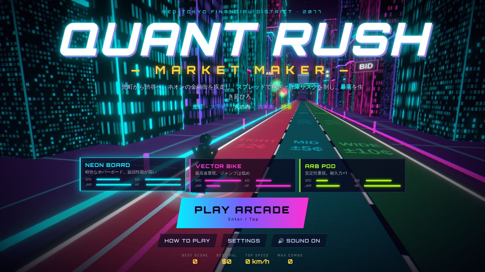
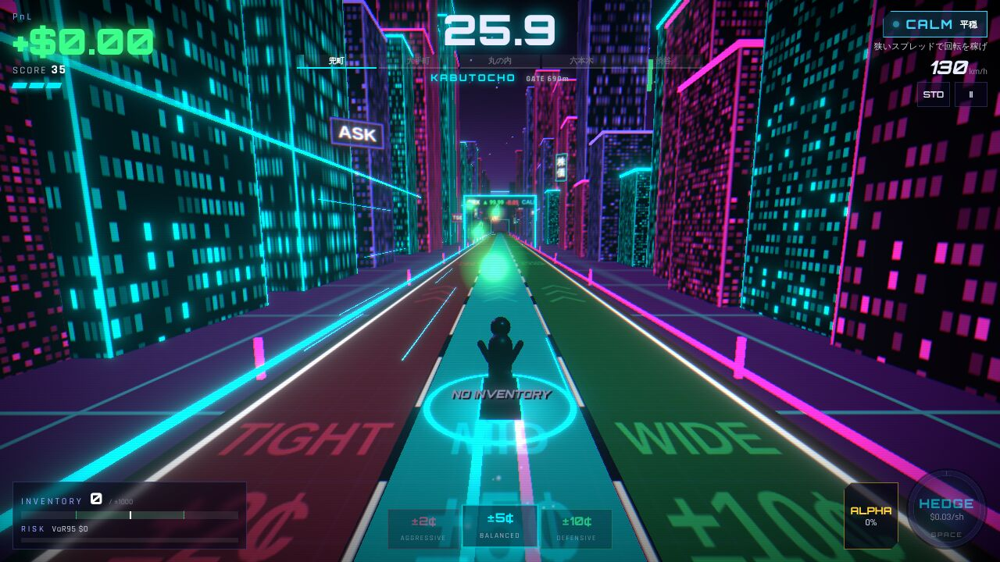
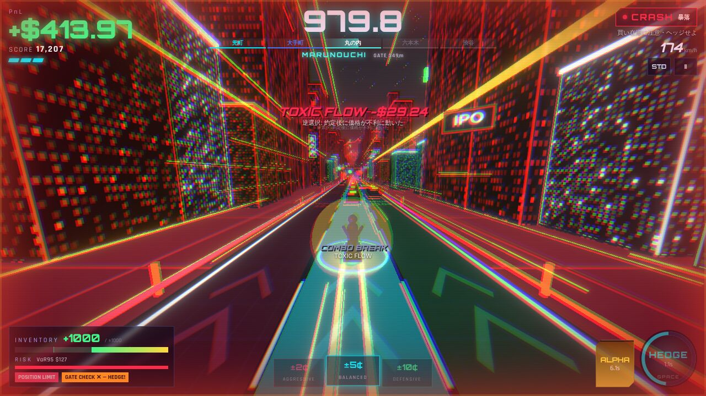
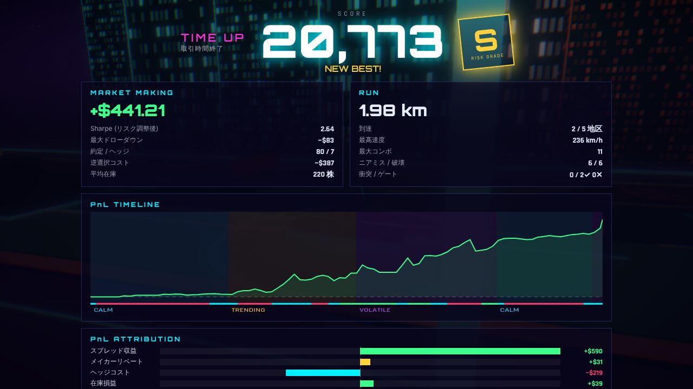
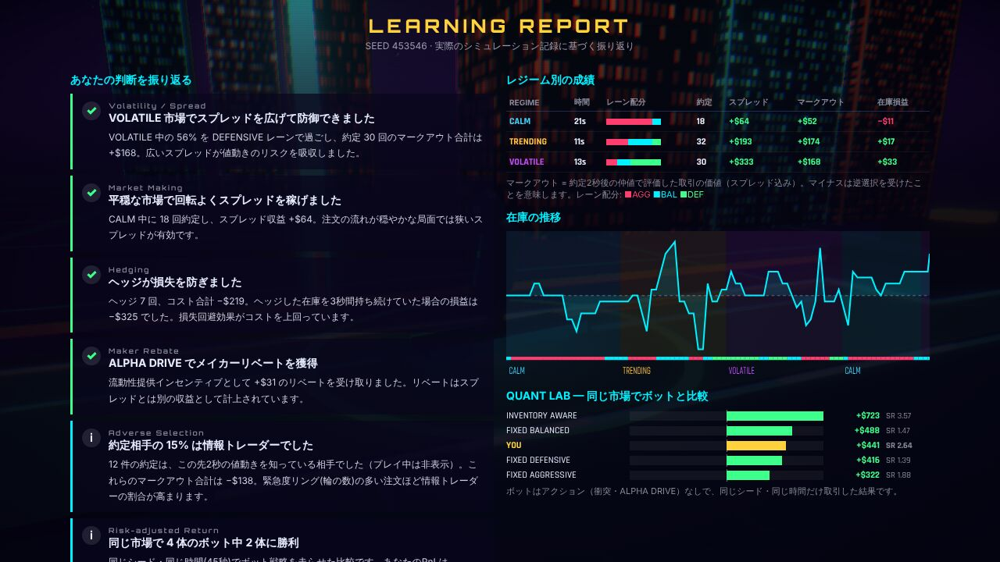
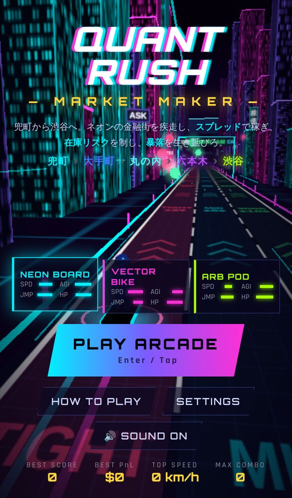
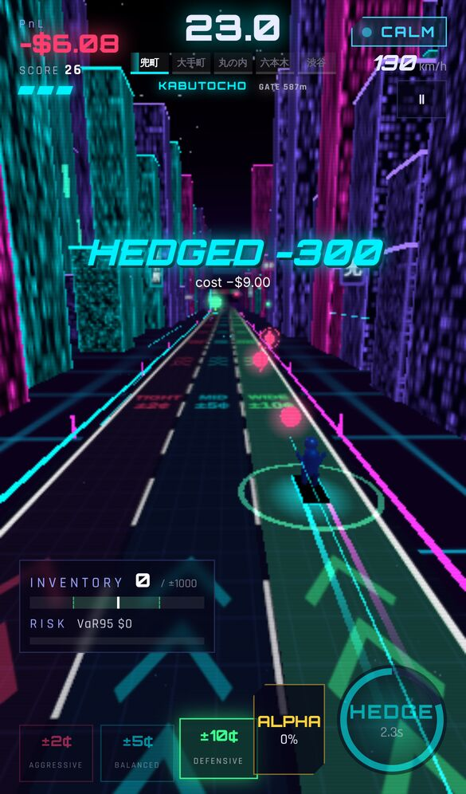

# QUANT RUSH — Market Maker

**ネオン東京の金融街を疾走し、スプレッドで稼ぎ、在庫リスクを制し、暴落を生き延びる 3D アーケードゲーム。**

兜町 → 大手町 → 丸の内 → 六本木 → 渋谷。高速道路のような金融都市を駆け抜けながら、あなたは**マーケットメイカー**として次々に飛んでくる注文を捌きます。走るレーンがそのまま提示スプレッドになり、障害物を避け、ニアミスでゲージを溜め、ALPHA DRIVE で街を突き破る。金融の仕組みを知らなくても遊べ、知っている人ほど深く戦略を練れるゲームです。



| プレイ画面 | 暴落 + ALPHA DRIVE |
|---|---|
|  |  |
| **リザルト** | **LEARNING REPORT** |
|  |  |

<p align="center"> </p>

---

## 遊び方

### 操作

| PC | スマートフォン | アクション |
|---|---|---|
| `A` / `←`・`D` / `→` | 左右スワイプ（画面端タップでも可） | レーン移動 = スプレッド変更 |
| `W` / `↑` | 上スワイプ | ジャンプ（低いバリアを飛び越える） |
| `Space` | HEDGE ボタン | ヘッジ：在庫をゼロにする（コストあり・3秒クールダウン） |
| `Shift` / `S` / `↓` | 下スワイプ / ALPHA ボタン | ALPHA DRIVE 発動（ゲージ満タン時） |
| `C` | カメラボタン | カメラ切替：標準 / 迫力 / 一人称 |
| `P` / `Esc` | II ボタン | ポーズ |
| `Enter` / `R` / `L` | — | タイトル→開始 / リザルト→リトライ / 学習レポート |

### ルール

- プレイヤーは自動で前進。**残り時間がゼロ**、**耐久ゼロ（KNOCKOUT）**、**PnL が −$3,000（STOPPED OUT）** のいずれかで終了。
- 開始時の持ち時間は 28 秒。各地区の終点にある **SETTLEMENT GATE** を通過すると時間が延長されます。
  - ゲートでは**在庫チェック**：|在庫| ≤ 500 株なら **PASS +18秒**（耐久1回復・ボーナス）、超過なら **FAIL +8秒**。
  - → ゲート前にヘッジするか、在庫を偏らせない立ち回りが必要。リスク管理が「先に進む力」になります。
- 渋谷に到着すると GOAL ボーナス。以降は **OVERTIME LAP**（高速・高密度）で時間が尽きるまで周回。
- 1プレイは通常 60〜90 秒（自動操縦での平均 76 秒）。

### レーン = あなたのスプレッド

| レーン | 提示スプレッド | 約定条件 | 特徴 |
|---|---|---|---|
| LEFT · AGGRESSIVE | ±2¢ | リング1個以上 | 約定しやすい・1回の利益は小さい・情報トレーダーに狙われやすい |
| CENTER · BALANCED | ±5¢ | リング2個以上 | バランス型 |
| RIGHT · DEFENSIVE | ±10¢ | リング3個 | 約定は少ないが1回の利益が大きく、急変動に強い |

前方から飛んでくる光の玉が**テイカー（他の投資家）の注文**です。緑 = 買い注文（あなたが売る → 在庫減）、赤 = 売り注文（あなたが買う → 在庫増）。玉を囲む**リングの数**は「その注文がどこまで広いスプレッドを払うか（緊急度）」を表します。

### アクション要素

- **障害物**：自動運転タクシー（車線変更あり）、サーキットブレーカー（ジャンプで越える低いバリア、3車線全幅もあり）、ボラティリティ・スパイク（VOLATILE/CRASH 時）、落下デブリ（CRASH 時・着地点に警告リング）。
- **衝突**すると転倒して耐久 −1、約 1.4 秒**クォートが停止**（その間の注文は約定しない＝機会損失）、コンボ消滅、ゲージ −25%。
- **ニアミス**（障害物すれすれの回避・ギリギリのジャンプ）でポイント、コンボ +1、ALPHA ゲージ +12%。
- **コンボ**：約定・ニアミス・ゲート通過で増加。5コンボごとに倍率 +0.25（最大 ×3）。逆選択（TOXIC FLOW）や衝突でリセット。
- **ALPHA DRIVE**（LIMIT BREAK に相当する独自の特殊能力）：6.5 秒間の無敵・超加速・障害物破壊（SMASH）・スコア 2 倍。さらに取引所の**メイカーリベート**（1株 $0.01）を受け取ります。リベートは PnL に**別建て**で計上され、損失を消すことはありません。
- 3 種類のマシン（NEON BOARD / VECTOR BIKE / ARB POD）、3 種類のカメラ、画面ロール ON/OFF、画質切替、効果音・BGM 個別ミュート。
- 最高スコア・最高 PnL・最高速度・最大コンボと設定は `localStorage` に保存。

---

## 金融ロジック

市場モデルは `src/sim/` に、描画や React から完全に独立した純 TypeScript モジュールとして実装しています。

### 市場（テープ）

`generateTape(seed)` が 1 シード分の市場シナリオを**事前生成**します（`src/sim/tape.ts`）。

- **4 つのレジーム**：CALM / TRENDING / VOLATILE / CRASH。最初は CALM、以後ランダムに遷移し、35〜58 秒付近で 85% の確率で CRASH（その後 VOLATILE で余震）。
- **仲値（mid）**：算術ランダムウォーク + ドリフト（TRENDING は ±、CRASH は下落）+ ジャンプ。
- **注文フロー**：ポアソン到着。各注文は `side, qty, willingness（許容ハーフスプレッド）, informed, queueDraw` を持つ。
  - **ノイズトレーダー**：方向はほぼランダム（トレンド時は追随気味）、許容スプレッドは指数分布（ボラが高いほど急いでいる＝広いスプレッドを払う）。
  - **情報トレーダー**：この先 2 秒の値動きを知っており、その方向に取引する。許容スプレッドは値動きの 50〜100%。比率は CALM 5% → CRASH 35%。
- テープはプレイヤーの行動に一切依存しません。**同じシード = 同じ市場**、**同じシード + 同じ操作 = 同じ結果**（テストで検証）。

### 約定と会計（`src/sim/engine.ts`）

1 ティック = 0.05 秒。各ティックで：

1. **ヘッジ**：在庫 `q` を仲値 ± コストで反対売買（`cost/株 = $0.03 + レジーム加算`、CRASH では $0.09）。
2. **約定判定**：その時刻に到着した注文について
   - クォート停止中（転倒中）→ `OFFLINE`
   - `willingness < 自分のハーフスプレッド` → `PRICE`（スプレッドが広すぎて取られない）
   - `queueDraw ≥ queueWin(レーン)` → `QUEUE`（他のメイカーに取られる。狭いほど優先度が高い）
   - 在庫上限 ±1,000 株を超える分 → `LIMIT`（部分約定あり）
   - 約定：テイカー買いには `ask = mid + h` で売り、テイカー売りには `bid = mid − h` で買う。
3. **時間経過**：仲値が動き、在庫が時価評価される。

**単一の真実**は `cash` と `inventory` だけです：

```
PnL = Cash + Inventory × MidPrice − InitialEquity
```

- 約定時：`cash -= qty × price; inventory += qty`
- ヘッジ時：同様に `cash` と `inventory` を更新（コストは約定価格に含まれる）
- リベート：`cash += |qty| × $0.01`

説明用の内訳（スプレッド収益・リベート・ヘッジコスト・在庫損益）は別途記録しますが、PnL には加算しません。テストで次の恒等式を検証しています（二重計上がないことの確認）：

```
PnL ≡ SpreadPnL + RebatePnL − HedgeCost + InventoryPnL     （InventoryPnL = Σ inventory_t × Δmid_t）
```

### 逆選択・マークアウト

各約定は 2 秒後の仲値で評価（**マークアウト** = `qty × (mid[t+2s] − 約定価格)`）。マイナスなら「**TOXIC FLOW**」としてコンボが切れます。この判定は 2 秒経過後の“過去の情報”として行われるため、未来情報の漏洩ではありません。

### 未来情報を見せない

`engine.observe()` が返すのは現在の仲値・レジーム・在庫・実現ボラ・VaR と、**すでに出現して飛来中の注文**（side, qty, 緊急度リング, 到着までの時間）のみ。`informed` フラグ・`willingness` の正確な値・将来価格は観測に含まれません（テストで検証）。学習レポートだけがゲーム終了後に情報トレーダーの割合などを開示します。

### レーン設計（常に同じレーンが有利にならない）

`npm run lab` の結果（200 シード × 90 秒、同一市場で比較）：

| レジーム | AGG ±2¢ | BAL ±5¢ | DEF ±10¢ | 有利なレーン |
|---|---|---|---|---|
| CALM | **+4.7 $/s** | +3.4 | +0.8 | AGGRESSIVE（狭く回転） |
| TRENDING | +0.7 | +7.0 | **+7.2** | BALANCED〜DEFENSIVE |
| VOLATILE | +4.0 | +15.1 | **+19.9** | DEFENSIVE（広く守る） |
| CRASH | −98.6 | −79.3 | **−56.0** | DEFENSIVE + ヘッジ必須 |

（マークアウトベース、在庫の持ち越し損益を除く）

| 戦略 | 平均 PnL | 標準偏差 | Sharpe | 最大DD |
|---|---|---|---|---|
| FIXED AGGRESSIVE | −650 | 685 | −1.01 | 1178 |
| FIXED BALANCED | −162 | 714 | −0.04 | 1023 |
| FIXED DEFENSIVE | +57 | 771 | 0.44 | 958 |
| FIXED BALANCED + HEDGE | +78 | 445 | 0.67 | 593 |
| **INVENTORY AWARE**（レジーム適応 + VaR ヘッジ） | **+433** | 426 | **1.68** | 429 |
| RANDOM | −355 | 556 | −0.52 | 918 |

固定戦略は勝てず、**レジームに合わせてスプレッドを変え、在庫を管理する**戦略が最も高いリスク調整後リターンを出します。これがゲームの核です。

### スコア

```
Score = PnL×10 × リスク倍率（PnL>0 のとき, Sharpe と在庫上限張り付き率で 0.6〜2.5）
      + 取引ポイント（スプレッド×10×コンボ倍率, ALPHA 中 2倍）
      + アクションポイント（ニアミス・破壊・ゲート・距離）
```

リスクグレード S〜D は Sharpe・リターン/最大ドローダウン・上限張り付き率から算出します（`src/sim/scoring.ts`）。

### LEARNING MODE

リザルトから **LEARNING REPORT** を開くと、実際のシミュレーション記録だけから振り返りを生成します（`src/sim/analysis.ts`）：

- 高ボラ/暴落局面での AGGRESSIVE 滞在率とそのマークアウト（逆選択）
- 平穏局面で DEFENSIVE にいたため逃した約定数と取り逃したスプレッド（テープから反実仮想を計算）
- 在庫上限への張り付き率、最大在庫
- ヘッジのコストと、ヘッジしなかった場合の 3 秒後損益の比較
- 暴落開始時の在庫と暴落中の損益
- 情報トレーダーとの約定比率（終了後に開示）
- 転倒によるクォート停止で逃した約定、ALPHA DRIVE のリベート
- **QUANT LAB 比較**：同じシード・同じ時間でボット 4 種を走らせた結果とあなたの比較

---

## QUANT LAB（拡張設計）

- `Strategy` インターフェース（`decide(observation) → action`）で戦略を差し替え可能（`src/sim/strategies.ts`）
- 実装済み：`RandomStrategy` / `FixedSpreadStrategy`（+ 在庫閾値ヘッジ）/ `InventoryAwareStrategy`
- `runEpisode(seed, strategy)`、`replay(seed, actions)`、`benchmarkStrategies()`
- CLI：`npm run lab -- <seeds> <seconds>`
- 観測・行動は数値のみの単純な構造なので、Python（Gymnasium 等）への移植や強化学習エージェントの接続が容易です。テープ生成 → エンジンの `step(action)` → `observe()` がそのまま環境の `reset/step` に対応します。

---

## 技術スタック・構成

Vite 7 / React 19 / TypeScript / Three.js / React Three Fiber / Drei / @react-three/postprocessing / Zustand / Vitest / Playwright

```
src/
  sim/      市場シミュレーター（DOM非依存）: rng, config, tape, engine, scoring, strategies, analysis (+ tests)
  game/     アクション層とアプリ状態: session(走行・障害物・ゲート・ALPHA), store(Zustand), audio(WebAudio合成), input, autopilot (+ tests)
  scene/    3D描画 (R3F): 道路, 都市, 看板, ティッカー, 空の価格チャート, プレイヤー, 注文オーブ, 障害物, ゲート, パーティクル, カメラ
  ui/       HUD, タイトル, リザルト, 学習レポート, チャート(SVG)
scripts/    quantlab.ts（戦略比較）, balance.ts（難易度チェック）
tests/      Playwright E2E
```

- アセットファイルなし：テクスチャはすべて Canvas で生成、効果音・BGM は WebAudio でリアルタイム合成（オリジナル）。
- 固定タイムステップ（60Hz アクション / 20Hz 市場）でフレームレートに依存しない決定的シミュレーション。
- 軽量化：インスタンシング、オブジェクトプール、`PerformanceMonitor` による自動解像度調整、LOW 画質（ポストエフェクト無効）、モバイル既定 LOW。

## 開発

```bash
npm install
npm run dev        # http://localhost:5173
npm test           # Vitest（金融ロジック・PnL整合性・決定性・アクション層）
npm run build      # 型チェック + 本番ビルド → dist/
npm run e2e        # Playwright（初回は npx playwright install chromium が必要な場合あり）
npm run lab        # QUANT LAB 戦略比較
npm run balance    # 自動操縦による難易度チェック
```

## Cloudflare Pages への公開

完全静的サイトです（サーバー・API キー・DB 不要）。

**ダッシュボードから**
1. Cloudflare ダッシュボード → Workers & Pages → Create → Pages → Connect to Git
2. このリポジトリを選択
3. Framework preset: `None`（または Vite）／ Build command: `npm run build` ／ Build output directory: `dist`
4. 環境変数 `NODE_VERSION=22` を設定して Save and Deploy

**CLI から**
```bash
npm run build
npx wrangler pages deploy dist --project-name quant-rush
```

`public/_headers` でハッシュ付きアセットに長期キャッシュを設定済み。`base: './'` なのでサブパスでも動作します。

## 今後の改善候補

- 実機スマートフォンでのフレームレート計測と描画負荷の追加調整
- リプレイ再生（入力ログは記録済み：`GameSession.inputLog` / `engine.actions`）とゴースト走行
- QUANT LAB の UI 化（ブラウザ上でボット同士・自分との対戦、パラメータ調整）
- Python 版環境（Gymnasium ラッパー）と強化学習エージェントの学習・比較
- 在庫に応じたクォートの非対称化（スキュー）操作の追加
- デイリーシード・ランキング（静的サイトのまま実現するなら共有 URL 方式）
- 地区ごとの固有ランドマーク・BGM バリエーション
